<h3>Summary</h3>

*Open Palaeontology* (ISSN: 3042-657X) is an international, diamond open access journal promoting open science in palaeontology. Our mission is to provide a flexible publishing platform for quality science that is free and accessible to authors and readers everywhere. The journal accepts research on widely applicable advances within the field in knowledge or methodology, and regional case studies of broader interest to the palaeontological community.

I am President of the governing association (since 2026), co-founded the journal in late 2024, develop journal policies as part of the Steering Committee (since 2024), and manage the journal's submissions and team of Handling Editors as an Editorial Manager.

{width="100"} {fig-align="center" width="305"} {width="100"}

<h3>Support</h3>

<h5>SOAP2:</h5>

*Open palaeontology* is hosted and supported by [SOAP2](https://www.soap2.ch), as part of a consortium of universities in Switzerland. The SOAP2 team provides support, hosting, use of the OJS platform, and assistance with journal maintenance.

<h5>BCUL open access fund:</h5>

Awarded a grant for CHF 10,000 during 2025—26 to develop the journal, used to redesign the website and develop new branding.

<h3>Links</h3>

- [*Open Palaeontology*](https://openpalaeo.org) journal website

- Our published [editorial](https://www.openpalaeo.org/article/view/6223) explaining the reasoning behind starting *Open Palaeontology*, the journal's structure, and our flexible publishing model

- [Preprint](https://eartharxiv.org/repository/view/5492/) in *EarthArXiv* by Drage and Wong Hearing (journal co-founders) on the current state of academic publishing
