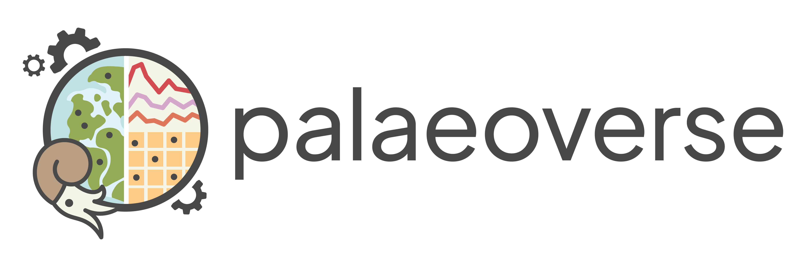

<h5>Funding agency:</h5> Institute of Research Software (UKRI), Research Software Maintenance Fund grant

<h5>Grant reference:</h5> AH/Z000114/1

<h5>Period:</h5> 2026 –- 28

<h5>Project co-leads:</h5> Lewis A. Jones, University College London, UK (Lead applicant) \| Dr Bethany J. Allen, GFZ Helmholtz Centre for Geosciences, Germany **\|** Dr Christopher D. Dean, Department of Energy Security and Net Zero, UK **\|** **Dr Harriet B. Drage**, University of Geneva, Switzerland **\|** Dr Erin M. Dillon, Smithsonian Tropical Research Institute, Panama **\|** Dr Joseph T. Flannery-Sutherland, University of Birmingham, UK **\|** Dr William Gearty, Syracuse University, USA **\|** Dr Pedro L. Godoy, University of São Paulo, Brazil

{fig-align="left" width="555"}

{width="1000"}{width="612"}

<h3>Summary</h3>

<h3>Links</h3>
